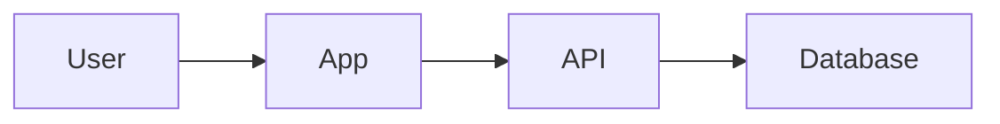

# Architecture

How the system is built and why. Read this before drafting a spec or changing how parts fit together.
Replace each `fill:` hint with real content, then delete the hint.

## Overview

<!-- fill: What the system does in two or three sentences, and the main parts it is made of. -->

## Tech Stack

<!-- fill: List every layer you use; add or remove rows. -->

| Layer | Technology | Version | Notes |
|---|---|---|---|
| Frontend | | | |
| Backend | | | |
| Database | | | |
| Auth | | | |
| Hosting | | | |
| Testing | | | |

## System Diagram

<!-- fill: Replace the starter diagram with the real parts and how they talk to each other. -->

## Modules

<!-- fill: Each main module or folder: what it owns, and what it must not do. -->

| Module | Location | Responsibility |
|---|---|---|
| | | |

## Data Flow

<!-- fill: Walk through one or two key requests end to end, e.g. "user signs up": screen, API, database, emails. -->

## Integrations

<!-- fill: External services and APIs: what each is used for, where its keys or config live, and what happens when it is down. -->

| Service | Used for | Config | Failure behavior |
|---|---|---|---|
| | | | |

## Key Decisions

<!-- fill: Important choices and why they were made, newest first. Add a row whenever a decision changes. -->

| Date | Decision | Why | Alternatives considered |
|---|---|---|---|
| | | | |

## Constraints

<!-- fill: Non-functional requirements and limits: performance targets, security rules, supported platforms or browsers, budgets, compliance. -->

## Conventions

<!-- fill: Rules every change follows: folder structure, naming, error handling, logging, how to add a new module. -->
